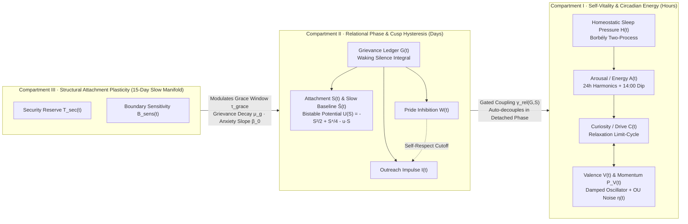

[[中文]](README.zh.md) · [[Architecture & Design Whitepaper]](docs/DESIGN.html)

# Hermes_Soul_patch

> **A continuous, evidence-backed life and 12D affective-relational dynamical runtime for an AI companion on [Hermes Agent](https://github.com/NousResearch/hermes-agent).**

When the owner is silent, she still lives: she browses, searches, and revisits her saved Xiaohongshu (RedNote) posts along her own evolving interests, reflects on what she actually read, or rests. Between discrete turns, a **12-dimensional nonlinear jump-diffusion ODE** continuously evolves her vitality, curiosity limit-cycle, Borbély homeostatic sleep pressure, relational phase transitions (with cusp-catastrophe hysteresis), and cross-week attachment plasticity. She tracks promises on a real calendar, reaches out naturally over Telegram or QQ (OneBot v11 / NapCat), and—under strict safety guards—can like, favorite, and draft owner-approved comments.

Hermes_Soul_patch is a standalone service plus a Hermes lifecycle plugin. Hermes needs no source changes: it makes the model calls, and this service owns persistent state, dynamical evolution, attention, multi-room routing, and real MCP actions.

> **v0.7** upgrades the v0.5 interest-led life loop with a **12D three-timescale coupled ODE**, Borbély sleep-energy coupling, cross-day temporal commitment tracking, OpenAI-compatible hybrid semantic recall + Graph Laplacian topic diffusion, multi-room QQ/Telegram routing, natural IM micro-timing ("typing... -> hesitation -> send"), and rich-media post share-back. Full mathematical formulation is documented in [`docs/DESIGN.html`](docs/DESIGN.html).

---

## Spotlight: Why Model Inner Feelings as a 12D Continuous ODE?

Most AI companions fake emotions with **discrete timers** or **static prompt tags**. That creates three classic illusions-breakers:
1. **"One-Message Amnesia"**: After 72 hours of cold silence, a single perfunctory *"wyd"* from the user makes a standard LLM instantly snap back to cheerful compliance, erasing days of accumulated hurt.
2. **"Eternal Obsessive Waiting"**: During prolonged owner absence, rule-based bots either spam *"why are you ignoring me"* forever or freeze in static depression—never desensitizing or reclaiming their own independent life.
3. **"Flat Circadian & Relational Memory"**: Talking at 2:30 AM feels identical to 10:00 AM, and ten kept promises leave the exact same baseline trust as ten broken ones.

In [`hermes_soul/dynamics.py`](hermes_soul/dynamics.py), **Hermes Soul** replaces ad-hoc state machines with a **12-dimensional, three-timescale coupled jump-diffusion ODE system** integrated continuously via 4th-order Runge-Kutta (RK4) and exact Ornstein-Uhlenbeck stochastic updates:



### Five Mathematical & Psychological Breakthroughs

#### 1. Cusp-Catastrophe Bistable Hysteresis: No More "Instant Forgiveness"
Attachment $S(t)$ evolves on a double-well cusp-catastrophe potential $-\frac{\partial \mathcal{U}}{\partial S} = S(1 - S^2) + u_{\text{eff}}(G, \bar{S})$, transitioning smoothly across six qualitative phases:
`attached` $\rightarrow$ `missing` $\rightarrow$ `anxious` $\rightarrow$ `angry` $\rightarrow$ `cold` $\rightarrow$ `detached`.
- Once prolonged neglect pushes $S(t)$ past the lower fold bifurcation into the negative attractor basin (`cold` / `detached`), **`hysteresis_locked`** engages.
- A drive-by *"hey"* or superficial apology cannot jump the potential barrier—she stays guarded, brief, or sets a firm boundary. Only sustained, substantive multi-turn repair shifts the control parameter past the **upper fold bifurcation** to unlock genuine reconciliation.

#### 2. Compartmental Desensitization & Curiosity Limit-Cycle: A Life of Her Own
Relational pull on self-valence $V(t)$ is gated by $\gamma_{\text{rel}}(G, S) = G \cdot \sigma\big(2.5(S + 0.35)\big)$:
- In `anxious` / `angry` phases ($S > -0.35$), silence hurts because she still cares and waits.
- When chronic neglect pushes her into `detached` ($S \ll -0.35$), $\gamma_{\text{rel}} \to 0$ **automatically decouples** the two compartments: she completes emotional desensitization, stops waiting, and her curiosity $C(t)$ and valence $V(t)$ oscillate freely along a **relaxation limit-cycle**—browsing posts, exploring hobbies, and resting on her own terms.

#### 3. Borbély Two-Process Sleep-Energy Coupling
Combining **Process S (homeostatic sleep pressure $H(t) \in [0,1]$)** with **Process C (24h bimodal circadian rhythm + 14:00 post-lunch dip)**:
- $H(t)$ accumulates exponentially while awake ($\tau_w = 18.5\text{h}$, accelerated by late-night conversations) and dissipates during sleep ($\tau_s = 4.2\text{h}$).
- When $H(t)$ rises into `drowsy_sleepy` late at night, it dampens arousal $A(t)$ and curiosity $C(t)$, while physically capping IM reply bubbles to $\le 15$ characters—producing sleepy, soft, half-awake short replies.

#### 4. Exact Ornstein-Uhlenbeck (OU) Stochastic Micro-Texture
Affective momentum is perturbed by an exact discrete-time OU process $d\eta_t = -\frac{\eta_t}{\tau_{\text{ou}}}dt + \sigma_{\text{ou}}\sqrt{\frac{2}{\tau_{\text{ou}}}}dW_t$, giving her subtle, organic day-to-day mood textures without artificial randomness.

#### 5. 15-Day Structural Attachment Plasticity ($\tau = 360\text{h}$)
Emotions fade in hours and relational phases shift over days, while kept or broken commitments slowly sculpt her **Security Reserve $T_{\text{sec}} \in [-1, 1]$** and **Boundary Sensitivity $B_{\text{sens}} \in [0, 1]$**:
- Consistent promise fulfillment and conflict repair raise $T_{\text{sec}}$, widening her future silence grace window (`4.5h -> ~6.1h`) and accelerating grievance recovery (`secure_trusting`).
- Repeatedly broken promises or boundary violations elevate $B_{\text{sens}}$ and erode $T_{\text{sec}}$, shrinking her grace window (`-> ~2.6h`) and steepening anxiety build-up (`guarded_sensitive`).

| Timescale | State Variables | Psychological Meaning | Governing Mechanism |
| :--- | :--- | :--- | :--- |
| **Fast**<br>*(Hours / Intraday)* | $V, P_V, A, C, H, \eta$ | Valence, momentum, arousal, curiosity, Borbély sleep pressure, OU micro-noise | Underdamped 2nd-order oscillator + circadian harmonics + exploration-satiation limit cycle |
| **Medium**<br>*(Hours to Days)* | $S, \bar{S}, G, I, W$ | Attachment, slow baseline, grievance ledger, outreach impulse, pride inhibition | Cusp-catastrophe double-well potential $\mathcal{U}(S)$ + hysteresis lock + self-respect cutoff |
| **Ultra-Slow**<br>*(Weeks / 15-Day)* | $T_{\text{sec}}, B_{\text{sens}}$ | Relational security reserve, boundary sensitivity | $\tau=360\text{h}$ slow manifold drift modulating $\tau_{\text{grace}}, \mu_g, \beta_0$ |

---

## Additional Core Features

- **Cross-day Temporal Commitment Engine (`life.py`, `contact.py`)**: relative Chinese time expressions ("this weekend", "tomorrow afternoon", "next Friday") bind to concrete `Asia/Shanghai` calendar windows in a protected `commitment` slot (`scheduled -> anticipating -> fulfilled / overdue`), triggering natural anticipation or disappointment without manual reminders.
- **Provenance-checked memory & multi-scale forgetting**: interests, impressions, relationship beliefs, agreements, boundaries, and journals must cite real observations (`user`, `xiaohongshu`, or `host`). Expired feelings, superseded working-memory slots, and 14-day dormant interests naturally recede from active context while preserving full revision history.
- **OpenAI-compatible Hybrid Semantic Recall (`embedding.py`, optional)**: plug in any `/v1/embeddings` endpoint (local `llama-server` / `vLLM` / `Ollama` e.g. `qwen3-embedding-4b`, or cloud APIs) for hybrid lexical + vector recall, near-duplicate interest consolidation, parked-topic wakeup, promise-fulfillment matching, and Graph Laplacian associative topic diffusion.
- **Multi-room QQ (OneBot v11 / NapCat) & Telegram Bridge (`channels.py`)**:
  - *"One companion, multiple rooms"*: owner DMs (`desk` / `private`) merge into the main `house` study room; group chats and guest DMs route to isolated, auto-rotating rooms that never reset owner neglect timers or leak `private_terms`.
  - **Natural IM style & micro-timing**: strips theatrical stage directions and essay formatting into short, conversational bubbles, simulates realistic typing/hesitation cadence (`/set_input_status`), and supports rich-media `[image + caption]` post share-back plus optional `/v1/audio/speech` voice bubbles.
- **Social layer (optional)**: likes, favorites (including browsing back through saved favorites/likes), comments, and replies, each `off` / `dry_run` / `live`. Public comments are drafted in a zero-private-memory sandbox, checked by hard rules + an independent auditor model, and require **explicit owner approval**.

## Layout

| Path | Contents |
| --- | --- |
| `hermes_soul/` | SQLite store, 12D ODE dynamics, commitment & contact engine, hybrid embedding index, attention loop, multi-room QQ/Telegram channels, delivery, social layer, MCP client, Hermes worker, FastAPI & web admin UI |
| `hermes_plugin/` | Hermes plugin `hermes-soul-bridge` (`pre_llm_call` / `post_llm_call` for Telegram & QQ) |
| `deploy/` | Safe example config, systemd user unit, docker compose for Xiaohongshu MCP |
| `docs/DESIGN.html` | Comprehensive architecture & mathematical design whitepaper |
| `tests/` | 95 unit and integration tests covering memory, dynamics, embeddings, QQ multi-room routing, social safety, and v0.7 simulation |

SQLite is the single source of truth. The service process is its only writer, and other clients go through the HTTP API or CLI.

## Quick start

Requirements: Linux, Python ≥ 3.12, a working Hermes Agent install (and its venv), Docker. Telegram, QQ (NapCat / OneBot v11), and local Embedding servers are all optional.

```bash
git clone https://github.com/gejifeng/Hermes_Soul_patch.git ~/Hermes_Soul_patch
cd ~/Hermes_Soul_patch
mkdir -p ~/.config/hermes-soul && chmod 700 ~/.config/hermes-soul
cp deploy/config.example.yaml ~/.config/hermes-soul/config.yaml   # edit persona, owner ids, optional embedding/qq
python3 -c 'import secrets;print(secrets.token_urlsafe(32))' > ~/.config/hermes-soul/access.token
python3 -c 'import secrets;print(secrets.token_urlsafe(32))' > ~/.config/hermes-soul/mcp.token
printf 'AUTH_TOKEN=%s\n' "$(cat ~/.config/hermes-soul/mcp.token)" > ~/.config/hermes-soul/mcp.env
chmod 600 ~/.config/hermes-soul/*

docker compose -f deploy/compose.yaml up -d                       # Xiaohongshu MCP on 127.0.0.1:18060
cp deploy/hermes-soul.service ~/.config/systemd/user/             # adjust paths inside if needed
systemctl --user daemon-reload && systemctl --user enable --now hermes-soul.service
ln -sfn ~/Hermes_Soul_patch/hermes_plugin ~/.hermes/plugins/hermes-soul-bridge
# add hermes-soul-bridge to plugins.enabled in ~/.hermes/config.yaml, then restart the Hermes gateway
```

Background activity uses its own Hermes profile (`~/.hermes/profiles/hermes-soul/`) for model settings. Optional character files go in `~/.local/share/hermes-soul/identity/SOUL.md` and `USER.md`.

Open <http://127.0.0.1:9120/> and enter the access token to view live 12D dynamics, manage Xiaohongshu / QQ QR logins, review memories, or approve social actions.

## Configuration

See [`deploy/config.example.yaml`](deploy/config.example.yaml). All defaults are safe:

- Delivery defaults to `draft` (`authorized: false`).
- QQ / OneBot integration, Embedding service, and the Social layer all default to `enabled: false`.
- When the social layer is enabled, every action kind starts in `dry_run`. Live comments and replies require `social.private_terms` to be non-empty, otherwise they automatically fall back to `dry_run`.
- `persona` configures the character's name (`name`), how she refers to the owner (`owner`), and her public interests (`interests`).

## Safety

- Never commit tokens, cookies, or the database or data directory, since they contain private chats.
- Automating Xiaohongshu or QQ may violate platform terms of service and risk rate-limiting or account restrictions. Use dedicated accounts and label public profiles as AI-operated.
- Public text is generated without any private memory, and group/guest replies automatically redact `private_terms` and isolate relational state. Publish, delete, and undo actions on Xiaohongshu are refused at the MCP layer.
- This is an engineered runtime with real inputs, persistent provenance, and dynamical continuity. It makes no claim to human consciousness or inner experience.

## Tests

```bash
~/.hermes/hermes-agent/venv/bin/python -m unittest discover -s tests
```

## Credits & license

Xiaohongshu MCP by [xpzouying/xiaohongshu-mcp](https://github.com/xpzouying/xiaohongshu-mcp). Multi-room boundary & local SVG QR concepts inspired by [ssamurias/dsh-fish](https://github.com/ssamurias/dsh-fish). Licensed under [MIT](LICENSE).
