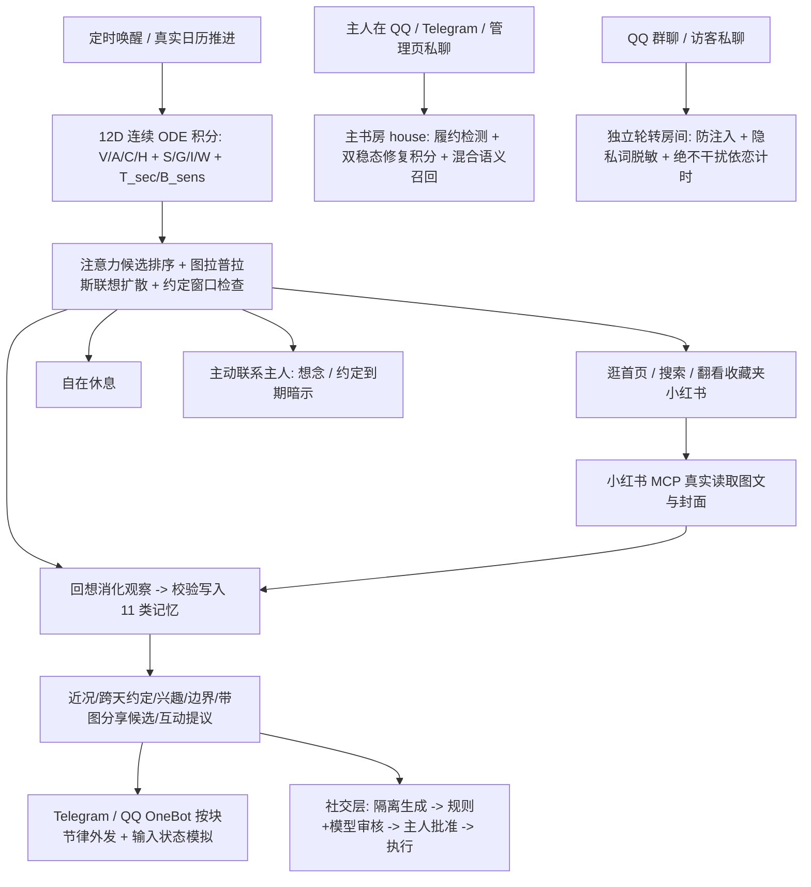

[[English]](README.md) · [[架构与详细设计白皮书 (HTML)]](docs/DESIGN.html)

# Hermes_Soul_patch

给 [Hermes Agent](https://github.com/NousResearch/hermes-agent) 上的 AI 角色一段**连续、有来源、具生理与依恋节律的生活**：主人不说话的时候，她也能去小红书闲逛、沿兴趣搜索、翻看自己的收藏夹、回想读过的东西或者休息；在离散对话之间，12 维连续常微分方程（ODE）实时演化她的生命力、探索欲、Borbély 睡眠困意、对主人的依恋相变（含双稳态滞回）以及跨周安全感可塑性；她会把随口约好的周末安排记在真实日历上，通过 Telegram 或 QQ（OneBot v11 / NapCat）自然地发短句、犹豫输入、顺手甩图文帖，并在严格审批下给喜欢的帖子点赞、收藏或评论。

这是一个独立运行的服务，加上一个 Hermes 生命周期插件。Hermes 核心代码不需要任何改动：Hermes 负责模型调用，本服务负责持久状态、连续动力学演化、注意选择、多房间隔离和真实的 MCP 操作。

> **v0.7** 在 v0.5 兴趣生活循环之上，新增了 **12D 三时间尺度耦合动力学（含 Borbély 双过程睡眠精力耦合与 15 天依恋结构可塑性）**、**跨天承诺生命周期引擎**、**OpenAI 兼容混合向量召回与图拉普拉斯话题扩散**、**QQ / OneBot 多房间融合架构**，以及**微观「欲言又止」输入状态节律与小红书带图分享**。完整数学建模与工程细节见 [`docs/DESIGN.html`](docs/DESIGN.html)。

## 核心特性

- **12 维三时间尺度连续心境与关系动力学（`dynamics.py`）**：
  - **自身生命力与 Borbély 睡眠-精力隔间**：效价 $V$、唤醒度 $A$、好奇心极限环 $C$ 与睡眠稳态压力 $H(t)$（清醒期 $\tau_w=18.5\text{h}$ 累积、深夜聊天额外耗能、睡眠期 $\tau_s=4.2\text{h}$ 恢复 + 午后 14:00 节律低谷），采用四阶 Runge-Kutta + 精确 Ornstein-Uhlenbeck 随机微涨落积分。熬夜犯困时自动收紧气泡字数，呈现真实的迷糊短句。
  - **关系相变与尖点突变滞回（Bistable Hysteresis）**：依恋度 $S$、慢速基线 $\bar{S}$、委屈度 $G$、主动冲动 $I$ 与自尊抑制 $W$ 驱动连续相变（`attached -> missing -> anxious -> angry -> cold -> detached`）。进入心冷/抽离期后触发双稳态滞回锁，杜绝长久冷落后一句敷衍问候就“一秒失忆破功”，唯有持续真诚沟通才能实质修复。
  - **跨周依恋结构可塑性（$\tau=360\text{h}$）**：持续兑现承诺与冲突修复会沉淀长期安全感储备 $T_{\text{sec}}$（拓宽未来断联宽限期、加快委屈消散），反复失约或越界则推高边界敏感度 $B_{\text{sens}}$。
- **跨天时间锚定与承诺闭环（`life.py`、`contact.py`）**：自动识别“这周末/明天下午/下周五/今晚”等自然语言相对时间，绑定到独立受保护的 `commitment` 槽位（不被日常刷帖近况挤掉），按真实日历驱动 `scheduled -> anticipating（到点惦记/暗示） -> fulfilled（履约升温） / overdue（爽约失落）`。
- **有来源的记忆与五层分尺度遗忘**：11 类结构化记忆强制校验证据引用（`user` / `xiaohongshu` / `host`）；通过工作记忆槽位顶替、TTL 自动淡出、14 天未接触兴趣转 `dormant`（重提可 `rekindled` 复燃）、局部等待暂放 `parked` 与 ODE 连续衰减实现拟人“遗忘”，同时保留完整修订审计链。
- **OpenAI 兼容混合语义召回（`embedding.py`，可选）**：支持接入任意 `/v1/embeddings` 服务（如本地核显/独显部署的 `qwen3-embedding-4b` 或云端 API），驱动中文双字 + 向量混合召回、近义兴趣自动归并、暂放话题跨措辞唤醒、履约语义判定与图拉普拉斯一步联想扩散。
- **多房间 QQ（OneBot v11 / NapCat）与 Telegram 融合（`channels.py`）**：
  - **一角色多间房**：主人私聊自动汇入主书房 `house` 共享记忆与依恋状态；QQ 群聊与访客私聊分居独立自动轮转房间，自动过滤提示词注入、脱敏 `private_terms`，且绝不重置主人冷落计时。
  - **去文章体口语化 + 微观输入犹豫 + 富媒体分享**：强力剥离括号神态旁白与三段式小作文；支持 OneBot `/set_input_status` 模拟敏感话题下的`正在输入… -> 停顿犹豫 -> 重新输入`，支持把刚读到的小红书笔记连同配图一起甩给主人，并预留 `/v1/audio/speech` 语音气泡接口。
- **小红书互动层（可选）**：支持点赞、收藏（及自主翻看收藏夹/点赞列表回味）、评论与回复，每类独立配置 `off` / `dry_run` / `live`。公开评论在零隐私隔离上下文中生成，经硬规则 + 独立审核模型把关，并由**主人在管理页批准**后方可执行。

## 架构概览



| 目录 | 内容 |
| --- | --- |
| `hermes_soul/` | SQLite 状态库、12D 动力学引擎、跨天承诺与联系感知、混合向量索引、注意循环、多房间渠道与本地 SVG 二维码、按块外发、社交层、MCP 客户端、Hermes worker、API 与管理页 |
| `hermes_plugin/` | Hermes 插件 `hermes-soul-bridge`（支持 Telegram 与 QQ 轮次桥接） |
| `deploy/` | 安全默认示例配置、systemd 用户服务、小红书 MCP 的 docker compose |
| `docs/DESIGN.html` | 系统设计思想、数学方程与工程细节白皮书 |
| `tests/` | 95 项单元与集成测试 |

## 快速安装

依赖：Linux、Python ≥ 3.12、可正常运行的 Hermes Agent（及其 venv）、Docker（小红书 MCP 用）。Telegram、QQ（NapCat）与本地 Embedding 服务均为可选模块。

```bash
git clone https://github.com/gejifeng/Hermes_Soul_patch.git ~/Hermes_Soul_patch
cd ~/Hermes_Soul_patch

# 1. 初始化安全配置
mkdir -p ~/.config/hermes-soul && chmod 700 ~/.config/hermes-soul
cp deploy/config.example.yaml ~/.config/hermes-soul/config.yaml
python3 -c 'import secrets;print(secrets.token_urlsafe(32))' > ~/.config/hermes-soul/access.token
python3 -c 'import secrets;print(secrets.token_urlsafe(32))' > ~/.config/hermes-soul/mcp.token
printf 'AUTH_TOKEN=%s\n' "$(cat ~/.config/hermes-soul/mcp.token)" > ~/.config/hermes-soul/mcp.env
chmod 600 ~/.config/hermes-soul/*
#    按需编辑 ~/.config/hermes-soul/config.yaml（persona、owner_ids、可选 embedding / qq 等）

# 2. 启动小红书 MCP（仅绑定 127.0.0.1:18060）
docker compose -f deploy/compose.yaml up -d

# 3. 启动 systemd 用户服务
mkdir -p ~/.config/systemd/user
cp deploy/hermes-soul.service ~/.config/systemd/user/
systemctl --user daemon-reload && systemctl --user enable --now hermes-soul.service

# 4. 可选：挂载 Hermes 生命周期插件
ln -sfn ~/Hermes_Soul_patch/hermes_plugin ~/.hermes/plugins/hermes-soul-bridge
```

打开 <http://127.0.0.1:9120/> 输入 `access.token`，即可查看实时 12D 心境动力学面板、扫码登录小红书或 QQ、管理独立群聊房间、查阅/纠偏记忆或审批公开互动。

## 安全与边界

- **切勿提交私人数据**：访问令牌、MCP 密钥、Telegram/OneBot token、Cookies，以及含私人对话的数据库或数据目录均已加入 `.gitignore`，严禁入库。
- **默认离线草稿与演练保护**：`config.example.yaml` 默认 `delivery.mode: draft`、`qq.enabled: false`、`social.enabled: false`、`embedding.enabled: false`。
- **公开与群聊严格隔离**：小红书评论生成上下文完全不含私人记忆；群聊/访客房间自动脱敏 `private_terms` 且与主人关系状态机物理隔离；MCP 层直接拒绝发帖与删除操作。
- **非意识声明**：本项目是有外界真实输入、证据溯源与连续动力学演化机制的工程系统，不声称实现人类意识或主观体验。

## 运行测试

```bash
~/.hermes/hermes-agent/venv/bin/python -m unittest discover -s tests
```

## 致谢与许可证

小红书 MCP 来自 [xpzouying/xiaohongshu-mcp](https://github.com/xpzouying/xiaohongshu-mcp)；多房间边界与本地零依赖二维码思路参考了 [ssamurias/dsh-fish](https://github.com/ssamurias/dsh-fish)。采用 [MIT](LICENSE) 许可证开源。
