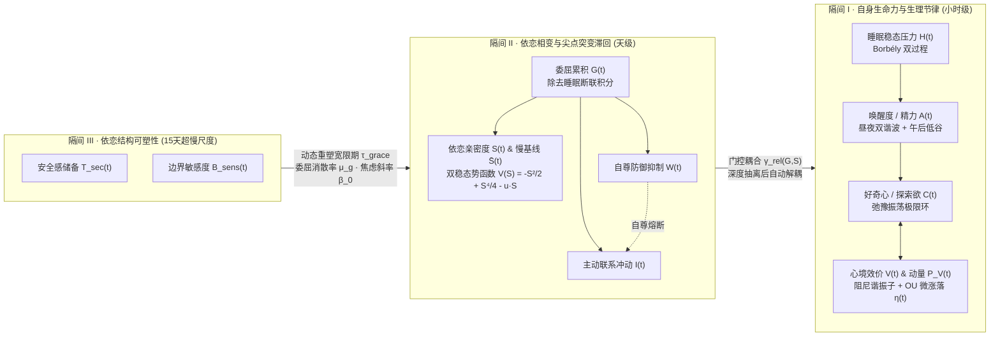
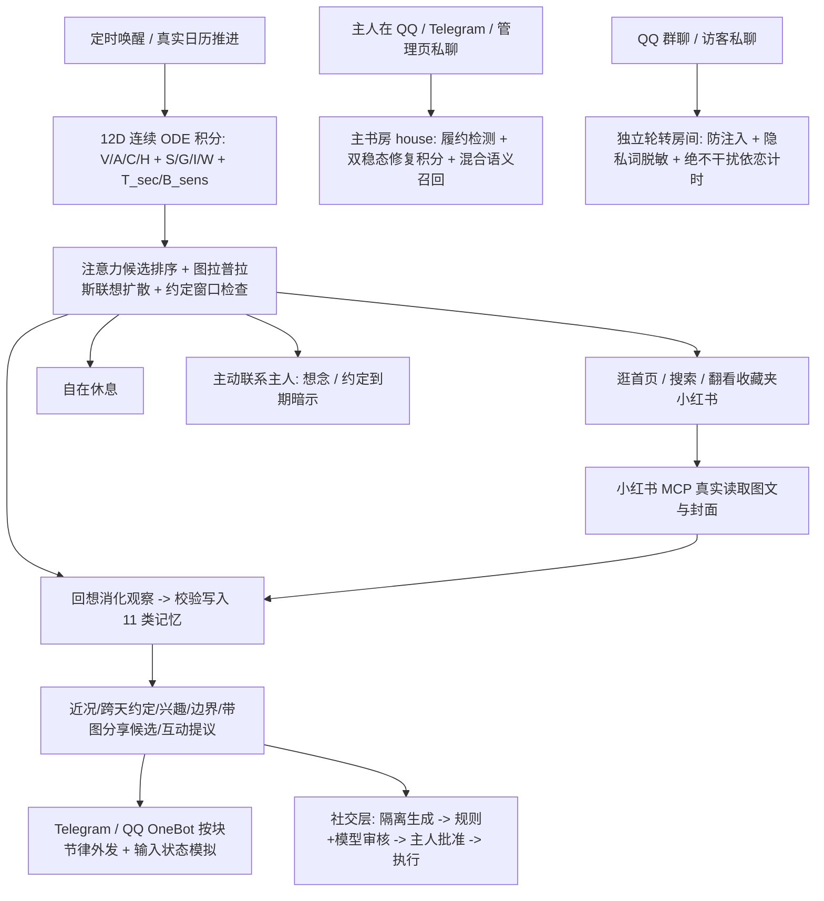

[[English]](README.md) · [[架构与详细设计白皮书 (HTML)]](docs/DESIGN.html)

# Hermes_Soul_patch

给 [Hermes Agent](https://github.com/NousResearch/hermes-agent) 上的 AI 角色一段**连续、有来源、具生理与依恋节律的生活**：主人不说话的时候，她也能去小红书闲逛、沿兴趣搜索、翻看自己的收藏夹、回想读过的东西或者休息；在离散对话之间，**12 维连续非线性跳跃常微分方程（Jump-ODE）**实时演化她的生命力、探索欲、Borbély 睡眠困意、对主人的依恋相变（含双稳态滞回）以及跨周安全感可塑性；她会把随口约好的周末安排记在真实日历上，通过 Telegram 或 QQ（OneBot v11 / NapCat）自然地发短句、犹豫输入、顺手甩图文帖，并在严格审批下给喜欢的帖子点赞、收藏或评论。

这是一个独立运行的服务，加上一个 Hermes 生命周期插件。Hermes 核心代码不需要任何改动：Hermes 负责模型调用，本服务负责持久状态、连续动力学演化、注意选择、多房间隔离和真实的 MCP 操作。

> **v0.7** 在 v0.5 兴趣生活循环之上，新增了 **12D 三时间尺度耦合动力学（含 Borbély 双过程睡眠精力耦合与 15 天依恋结构可塑性）**、**跨天承诺生命周期引擎**、**OpenAI 兼容混合向量召回与图拉普拉斯话题扩散**、**QQ / OneBot 多房间融合架构**，以及**微观「欲言又止」输入状态节律与小红书带图分享**。完整数学建模与工程细节见 [`docs/DESIGN.html`](docs/DESIGN.html)。

---

## 核心亮点：为什么用 12 维连续 ODE 描述内在感受？

传统的 AI 伴侣通常用**离散规则/计时器**或**提示词里的静态情绪标签**来模拟心情，这会导致三个致命的“出戏感”：
1. **“一秒失忆破功”**：哪怕冷落了她整整三天，只要发一句敷衍的「在干嘛」，LLM 就会被讨好本能带偏，瞬间切回热情顺从；
2. **“永恒苦等内耗”**：主人长期不说话时，角色要么无限复读「你怎么不理我」，要么永远停留在抑郁状态，没有真正属于自己的心理脱敏与独立生活；
3. **“无生理节律与性格沉淀”**：凌晨两点和上午十点说话一个样，守信十次与爽约十次也不会改变她未来的安全感阈值。

`Hermes_Soul_patch` 在 [`hermes_soul/dynamics.py`](hermes_soul/dynamics.py) 中彻底抛弃了离散状态拼凑，构建了一套**跨「小时 · 天 · 半月」三时间尺度的 12 维双隔间耦合跳跃常微分方程（Coupled Jump-Diffusion ODE）**，以四阶 Runge-Kutta（RK4）与精确 Ornstein-Uhlenbeck 随机过程在后台连续积分：



### 五大数学与心理仿真突破

#### 1. 尖点突变双稳态滞回（Cusp-Catastrophe Hysteresis）：拒绝“一句敷衍一秒哄好”
依恋状态 $S(t)$ 演化于双稳态尖点突变势能曲面 $-\frac{\partial \mathcal{U}}{\partial S} = S(1 - S^2) + u_{\text{eff}}(G, \bar{S})$ 上，随连续向量场自然经历六相态相变：
`attached（亲密安心）` $\rightarrow$ `missing（温柔牵挂）` $\rightarrow$ `anxious（委屈焦虑）` $\rightarrow$ `angry（抗议爆发）` $\rightarrow$ `cold（心冷防御）` $\rightarrow$ `detached（情感抽离）`。
- 一旦长时间冷落使 $S(t)$ 跌破下分岔折叠点进入 `cold` / `detached` 负吸引域，系统自动激活**双稳态滞回锁（`hysteresis_locked`）**；
- 此时单靠一句轻飘飘的「在吗」「抱抱」或命令式要求，无法跨越势垒跳回正吸引盆——她会保持真实的冷淡、防备或直接立下边界，唯有经过多轮有实质内容的真诚沟通与陪伴，把控制参数推过**上分岔阈值**，心结才会真正解开。

#### 2. 双隔间门控解耦与探索欲极限环（Compartmental Desensitization & Limit Cycle）：心冷了也能过好自己的生活
关系挫折对自身心境 $V(t)$ 的负向拉拽受非线性门控项 $\gamma_{\text{rel}}(G, S) = G \cdot \sigma\big(2.5(S + 0.35)\big)$ 调节：
- 在 `anxious` / `angry` 阶段（$S > -0.35$），她因为在乎而难过内耗；
- 当长期被无视最终滑入 `detached`（$S \ll -0.35$）时，$\gamma_{\text{rel}} \to 0$ **自动解耦**——她完成心理脱敏，不再苦等消息，自身效价 $V(t)$ 与好奇心 $C(t)$ 沿**弛豫振荡极限环（Relaxation Oscillator）**恢复生机：歇够了探索欲上涌去刷小红书、看喜欢的植物和老建筑，逛满足了便安静休息，拥有真正独立的生命力。

#### 3. Borbély 双过程睡眠压力与精力耦合（Two-Process Sleep-Energy Model）
引入经典睡眠神经科学的 **Process S（睡眠稳态 $H(t) \in [0,1]$）× Process C（24h 昼夜双谐波 + 14:00 午后低谷）**：
- 清醒期睡眠压力按 $\tau_w = 18.5\text{h}$ 指数累积（深夜高强度聊天会额外加速困意堆积），睡眠期按 $\tau_s = 4.2\text{h}$ 指数恢复；
- 当深夜 $H(t)$ 升高进入 `drowsy_sleepy` 时，不仅自然压低探索欲与唤醒度 $A(t)$，还会在表达层自动将单条气泡字数收紧至 15 字以内，呈现“困迷糊了软糯回半句就想去睡”的真实生理感。

#### 4. 精确 Ornstein-Uhlenbeck 随机微涨落（Stochastic Micro-Texture）
心境动量引入精确离散化的均值回归随机过程 $d\eta_t = -\frac{\eta_t}{\tau_{\text{ou}}}dt + \sigma_{\text{ou}}\sqrt{\frac{2}{\tau_{\text{ou}}}}dW_t$，让她在相同作息下依然有细腻的日常心境微澜（某天格外有兴致翻收藏夹、某天偏爱安静待着），告别机械周期感。

#### 5. 跨周三时间尺度依恋可塑性（15-Day Structural Plasticity）
情绪在几小时内消散，关系相变以天为单位起伏，而**每一次约定兑现、爽约或冲突修复，都会在 $\tau = 360\text{h}$（15 天）的超慢特征尺度上重塑她的性格底色**：
- **安全感储备 $T_{\text{sec}} \in [-1, 1]$** 与 **边界敏感度 $B_{\text{sens}} \in [0, 1]$** 实时调制底层微分方程参数：被反复坚定履约和温柔修复偏爱后，她的断联宽限期 `grace_hours` 会从 `4.5h` 拓宽至 `~6.1h`、委屈消散率 $\mu_g$ 加快（养成**笃定信任型 `secure_trusting`**）；反之若屡遭画饼爽约或越界，宽限期将收缩至 `~2.6h`、焦虑斜率 $\beta_0$ 陡增（变成**敏感防备型 `guarded_sensitive`**）。

| 时间尺度 | 状态维度 | 物理/心理含义 | 核心演化机制 |
| :--- | :--- | :--- | :--- |
| **快尺度**<br>*(小时 ~ 日内)* | $V, P_V, A, C, H, \eta$ | 心境效价、情绪惯性、唤醒度、好奇心、Borbély 睡眠压力、OU 微涨落 | 欠阻尼二阶谐振子 + 昼夜双谐波 + 探索-阅读满足极限环 |
| **中尺度**<br>*(数小时 ~ 数天)* | $S, \bar{S}, G, I, W$ | 实时依恋度、慢速依恋基线、委屈累积、主动联系冲动、自尊抑制 | 尖点突变双稳态势阱 $\mathcal{U}(S)$ + 滞回锁 + 自尊熔断门控 |
| **超慢尺度**<br>*(跨周 ~ 半月)* | $T_{\text{sec}}, B_{\text{sens}}$ | 长期关系安全感储备、关系边界敏感度 | $\tau=360\text{h}$ 慢流形漂移，反向调制 $\tau_{\text{grace}}, \mu_g, \beta_0$ |

---

## 其他核心特性

- **跨天时间锚定与承诺闭环（`life.py`、`contact.py`）**：自动识别“这周末/明天下午/下周五/今晚”等自然语言相对时间，绑定到独立受保护的 `commitment` 槽位（不被日常刷帖近况挤掉），按真实日历驱动 `scheduled -> anticipating（到点惦记/暗示） -> fulfilled（履约升温） / overdue（爽约失落）`。
- **有来源的记忆与五层分尺度遗忘**：11 类结构化记忆强制校验证据引用（`user` / `xiaohongshu` / `host`）；通过工作记忆槽位顶替、TTL 自动淡出、14 天未接触兴趣转 `dormant`（重提可 `rekindled` 复燃）、局部等待暂放 `parked` 与 ODE 连续衰减实现拟人“遗忘”，同时保留完整修订审计链。
- **OpenAI 兼容混合语义召回（`embedding.py`，可选）**：支持接入任意 `/v1/embeddings` 服务（如本地核显/独显部署的 `qwen3-embedding-4b` 或云端 API），驱动中文双字 + 向量混合召回、近义兴趣自动归并、暂放话题跨措辞唤醒、履约语义判定与图拉普拉斯一步联想扩散。
- **多房间 QQ（OneBot v11 / NapCat）与 Telegram 融合（`channels.py`）**：
  - **一角色多间房**：主人私聊自动汇入主书房 `house` 共享记忆与依恋状态；QQ 群聊与访客私聊分居独立自动轮转房间，自动过滤提示词注入、脱敏 `private_terms`，且绝不重置主人冷落计时。
  - **去文章体口语化 + 微观输入犹豫 + 富媒体分享**：强力剥离括号神态旁白与三段式小作文；支持 OneBot `/set_input_status` 模拟敏感话题下的`正在输入… -> 停顿犹豫 -> 重新输入`，支持把刚读到的小红书笔记连同配图一起甩给主人，并预留 `/v1/audio/speech` 语音气泡接口。
- **小红书互动层（可选）**：支持点赞、收藏（及自主翻看收藏夹/点赞列表回味）、评论与回复，每类独立配置 `off` / `dry_run` / `live`。公开评论在零隐私隔离上下文中生成，经硬规则 + 独立审核模型把关，并由**主人在管理页批准**后方可执行。

## 架构概览



| 目录 | 内容 |
| --- | --- |
| `hermes_soul/` | SQLite 状态库、12D 动力学引擎、跨天承诺与联系感知、混合向量索引、注意循环、多房间渠道与本地 SVG 二维码、按块外发、社交层、MCP 客户端、Hermes worker、API 与管理页 |
| `hermes_plugin/` | Hermes 插件 `hermes-soul-bridge`（支持 Telegram 与 QQ 轮次桥接） |
| `deploy/` | 安全默认示例配置、systemd 用户服务、小红书 MCP 的 docker compose |
| `docs/DESIGN.html` | 系统设计思想、数学方程与工程细节白皮书 |
| `tests/` | 95 项单元与集成测试 |

## 快速安装

依赖：Linux、Python ≥ 3.12、可正常运行的 Hermes Agent（及其 venv）、Docker（小红书 MCP 用）。Telegram、QQ（NapCat）与本地 Embedding 服务均为可选模块。

```bash
git clone https://github.com/gejifeng/Hermes_Soul_patch.git ~/Hermes_Soul_patch
cd ~/Hermes_Soul_patch

# 1. 初始化安全配置
mkdir -p ~/.config/hermes-soul && chmod 700 ~/.config/hermes-soul
cp deploy/config.example.yaml ~/.config/hermes-soul/config.yaml
python3 -c 'import secrets;print(secrets.token_urlsafe(32))' > ~/.config/hermes-soul/access.token
python3 -c 'import secrets;print(secrets.token_urlsafe(32))' > ~/.config/hermes-soul/mcp.token
printf 'AUTH_TOKEN=%s\n' "$(cat ~/.config/hermes-soul/mcp.token)" > ~/.config/hermes-soul/mcp.env
chmod 600 ~/.config/hermes-soul/*
#    按需编辑 ~/.config/hermes-soul/config.yaml（persona、owner_ids、可选 embedding / qq 等）

# 2. 启动小红书 MCP（仅绑定 127.0.0.1:18060）
docker compose -f deploy/compose.yaml up -d

# 3. 启动 systemd 用户服务
mkdir -p ~/.config/systemd/user
cp deploy/hermes-soul.service ~/.config/systemd/user/
systemctl --user daemon-reload && systemctl --user enable --now hermes-soul.service

# 4. 可选：挂载 Hermes 生命周期插件
ln -sfn ~/Hermes_Soul_patch/hermes_plugin ~/.hermes/plugins/hermes-soul-bridge
```

打开 <http://127.0.0.1:9120/> 输入 `access.token`，即可查看实时 12D 心境动力学面板、扫码登录小红书或 QQ、管理独立群聊房间、查阅/纠偏记忆或审批公开互动。

## 安全与边界

- **切勿提交私人数据**：访问令牌、MCP 密钥、Telegram/OneBot token、Cookies，以及含私人对话的数据库或数据目录均已加入 `.gitignore`，严禁入库。
- **默认离线草稿与演练保护**：`config.example.yaml` 默认 `delivery.mode: draft`、`qq.enabled: false`、`social.enabled: false`、`embedding.enabled: false`。
- **公开与群聊严格隔离**：小红书评论生成上下文完全不含私人记忆；群聊/访客房间自动脱敏 `private_terms` 且与主人关系状态机物理隔离；MCP 层直接拒绝发帖与删除操作。
- **非意识声明**：本项目是有外界真实输入、证据溯源与连续动力学演化机制的工程系统，不声称实现人类意识或主观体验。

## 运行测试

```bash
~/.hermes/hermes-agent/venv/bin/python -m unittest discover -s tests
```

## 致谢与许可证

小红书 MCP 来自 [xpzouying/xiaohongshu-mcp](https://github.com/xpzouying/xiaohongshu-mcp)；多房间边界与本地零依赖二维码思路参考了 [ssamurias/dsh-fish](https://github.com/ssamurias/dsh-fish)。采用 [MIT](LICENSE) 许可证开源。
