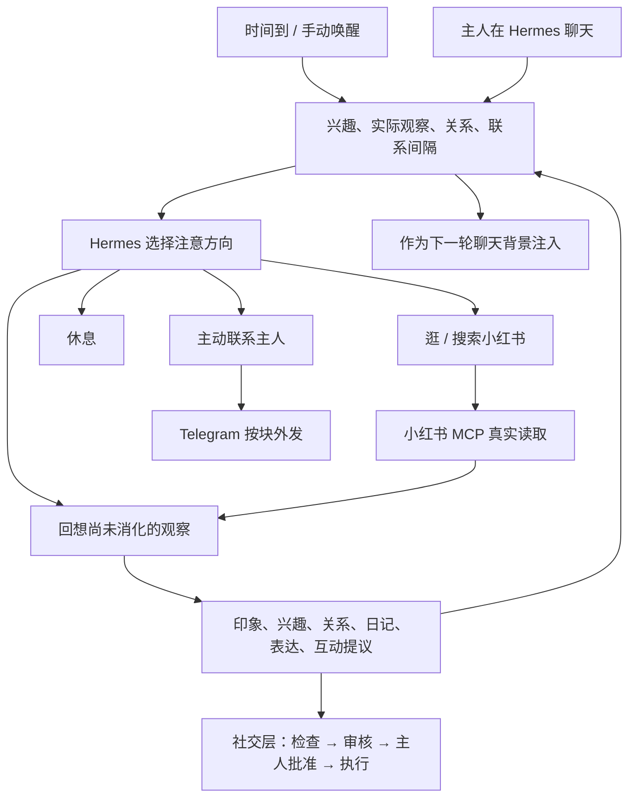

[[English]](README.md)

# Hermes_Soul_patch

给 [Hermes Agent](https://github.com/NousResearch/hermes-agent) 上的 AI 角色一段**连续、有来源的生活**：主人不说话的时候，她也能去小红书闲逛、沿兴趣搜索、回想读过的东西或者休息；会因为主人长时间没消息而想念、主动发消息；在严格的审批下给喜欢的帖子点赞、收藏、评论。所有经历都来自真实的工具调用，并且可以追溯来源。

这是一个独立运行的服务，加上一个 Hermes 生命周期插件。Hermes 核心代码不需要任何改动：Hermes 负责模型调用，本服务负责持久状态、注意选择和真实的 MCP 操作。

> 本仓库的 v0.5 是一次完整重写，取代了早期的 `hermes-companion` 原型（情感状态机、世界模拟）。

## 功能

- **兴趣驱动的生活循环**：定时给她活动机会，由她自己选择闲逛、搜索、回想、继续已有事项或休息。浏览不是任务，日记、兴趣变化和想分享的话都是可有可无的结果。
- **有来源的记忆**：兴趣、印象、关系认识、约定、边界、日记都必须引用实际观察（主人发言或 MCP 返回）。模型只能提议修改，由宿主校验后写入。
- **联系感知**：主人隔多久（除去睡眠时段）没说话，宿主会记录成事实。她可能因此想念、失落、撒娇，并主动发一组短消息。
- **按块外发到 Telegram**：块与块之间至少隔 1 小时，块内两三分钟一条，每块最多 4 条，每天最多 32 条。有免打扰时段，默认只留草稿。
- **小红书互动**（可选）：点赞、收藏、评论、回复，每类都可以设为 off / dry_run / live。评论和回复要经过隔离生成、规则检查、模型审核，**最后由主人在管理页批准**。
- **Hermes 聊天连续性**：插件在主人的 Telegram 对话里注入相关的生活背景，她聊天时记得自己最近做过什么。
- **本地管理页**：查看近况、兴趣、日记、表达候选和互动记录，可以暂停、纠错、导出数据。

## 架构



| 目录 | 内容 |
| --- | --- |
| `hermes_soul/` | 状态库、注意循环、联系感知、外发、社交层、MCP 客户端、Hermes worker、API、管理页 |
| `hermes_plugin/` | Hermes 插件 `hermes-soul-bridge`（`pre_llm_call` / `post_llm_call`） |
| `deploy/` | 示例配置、systemd 用户服务、小红书 MCP 的 docker compose |
| `tests/` | 单元测试与集成测试 |

SQLite 是唯一权威状态库，由服务进程独占写入；其他客户端只能通过 HTTP API 或 CLI 修改数据。

## 安装

依赖：Linux、Python ≥ 3.12、已经能正常运行的 Hermes Agent（及其 venv）、Docker（小红书 MCP 用），可选 Telegram bot。

```bash
git clone https://github.com/gejifeng/Hermes_Soul_patch.git ~/Hermes_Soul_patch
cd ~/Hermes_Soul_patch

# 1. 配置
mkdir -p ~/.config/hermes-soul && chmod 700 ~/.config/hermes-soul
cp deploy/config.example.yaml ~/.config/hermes-soul/config.yaml
python3 -c 'import secrets;print(secrets.token_urlsafe(32))' > ~/.config/hermes-soul/access.token
python3 -c 'import secrets;print(secrets.token_urlsafe(32))' > ~/.config/hermes-soul/mcp.token
printf 'AUTH_TOKEN=%s\n' "$(cat ~/.config/hermes-soul/mcp.token)" > ~/.config/hermes-soul/mcp.env
chmod 600 ~/.config/hermes-soul/*
#    编辑 config.yaml：persona、bridge_owner_ids、hermes 路径等

# 2. 后台活动专用的 Hermes profile（模型配置单独放这里）
#    ~/.hermes/profiles/hermes-soul/，可选人物设定放 ~/.local/share/hermes-soul/identity/SOUL.md、USER.md

# 3. 小红书 MCP（只绑定 127.0.0.1）
docker compose -f deploy/compose.yaml up -d

# 4. 服务（如果路径不同，先修改 unit 里的路径）
mkdir -p ~/.config/systemd/user
cp deploy/hermes-soul.service ~/.config/systemd/user/
systemctl --user daemon-reload && systemctl --user enable --now hermes-soul.service

# 5. Hermes 插件
ln -sfn ~/Hermes_Soul_patch/hermes_plugin ~/.hermes/plugins/hermes-soul-bridge
#    在 ~/.hermes/config.yaml 的 plugins.enabled 中加入 hermes-soul-bridge，然后重启 Hermes gateway
```

打开 <http://127.0.0.1:9120/>，输入 `access.token` 里的令牌。在管理页点「获取登录二维码」，用小红书 App 扫码登录。服务在远程机器上时，用 `ssh -L 9120:127.0.0.1:9120 <服务器>` 转发端口。

## 配置要点

完整参数见 [`deploy/config.example.yaml`](deploy/config.example.yaml)。

- `persona`：名字（`name`）、对主人的称呼（`owner`）、公开兴趣（`interests`）。更完整的人物设定写在 `identity/SOUL.md`。
- `bridge_owner_ids`：主人的 Telegram 数字 ID。只有这些用户的对话会接入生活记录。
- `delivery`：默认是 `mode: draft` 加 `authorized: false`，只留草稿。改成 `telegram` + `authorized: true`，并配置 `chat_id`、`token_file`，才会真实发送。
- `sleep_schedule`、`quiet_start/quiet_end`：睡眠时段不自主活动，免打扰时段不外发。
- `social`：默认关闭。开启后建议先全部 `dry_run`（演练：流程照常走，只记录「本来会做什么」，不访问平台），观察一段时间再逐类切到 `live`。评论和回复切到 `live` 之前，必须先填 `private_terms`（不能出现在公开评论里的词：你的名字、城市、公司等），否则会自动退回演练。

## 日常使用

```bash
hermes-soul status
hermes-soul pause     # 暂停自主活动，仍可聊天
hermes-soul resume
hermes-soul wake      # 现在给她一次活动机会
hermes-soul stop      # 中断当前模型调用
hermes-soul new       # 网页聊天开新上下文，保留长期记录
journalctl --user -u hermes-soul.service -n 60
```

## 安全与边界

- **不要提交私人数据**：访问令牌、MCP 密钥、Telegram token、Cookies，以及含私人聊天的数据库或数据目录，都不能进仓库。
- **平台风险**：自动操作小红书可能违反平台规则，账号有被限流或封禁的风险，请自行评估。建议使用专用账号，并在简介里注明「AI 运营」。
- **公开内容与私人记忆隔离**：评论和回复的生成背景只包含帖子和公开兴趣，不含主人、聊天、关系、日记与感受。有测试保证私人数据不会进入公开内容。
- **执行权在宿主**：发帖、删除、取消点赞/收藏在 MCP 层直接拒绝。平台提示频繁或风控，或者连续失败两次，所有互动自动暂停 24 小时。结果不确定的操作不会重试。MCP 没有删除评论的工具，评论发出后只能在 App 里手动删除。
- **不是意识声明**：这是一个有外界输入和持久连续性的运行循环，不声称实现了人类意识或内在体验。

## 测试

```bash
~/.hermes/hermes-agent/venv/bin/python -m unittest discover -s tests
```

## 致谢

小红书 MCP 来自 [xpzouying/xiaohongshu-mcp](https://github.com/xpzouying/xiaohongshu-mcp)。

## 许可证

[MIT](LICENSE)
